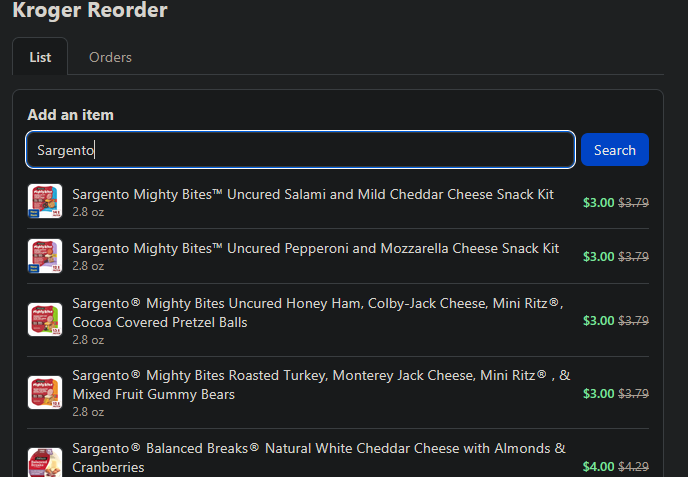
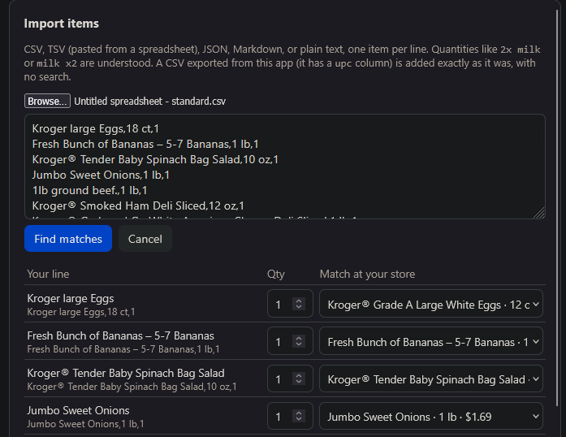
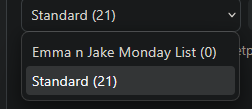

# Kroger Reorder

A small self-hosted web app that fills your Kroger pickup cart from saved grocery lists in one click. Keep several named lists, see product photos and sale prices, import and export lists as CSV, and look back at everything you have sent to the cart. Checkout (pickup time, payment) still happens in the Kroger app or at kroger.com, because Kroger's public API stops at the cart.

Runs on one Windows PC, is reachable from every phone on the same wifi, and stores everything as plain JSON files you can read and edit.

## Table of contents

- [Screenshots](#screenshots)
- [Features](#features)
- [Technology](#technology)
- [Project structure](#project-structure)
- [Getting started](#getting-started)
- [Running on startup](#running-on-startup)
- [Using the app](#using-the-app)
- [Data and privacy](#data-and-privacy)
- [HTTP API](#http-api)
- [Development](#development)
- [Design documents](#design-documents)
- [Limitations](#limitations)
- [Troubleshooting](#troubleshooting)
- [Resources](#resources)
- [Version history](#version-history)
- [License](#license)

## Screenshots

**Search your store and add items.** Results come from Kroger's catalog for the store you picked, with photos and the current sale price.



**Import a list from a file or pasted text.** Each line is matched against the catalog and reviewed before anything is added. A CSV exported from the app is added exactly, with no search.



**Keep several named lists.** Switch between them from the dropdown; each list is one JSON file on disk.



## Features

- **Named lists.** Create, rename, duplicate, and delete lists. Check or uncheck items per trip and set quantities.
- **Catalog search.** Search your chosen store and add products with their photo, size, and price.
- **Sale badges.** Promo prices show in green with the regular price struck through. Prices refresh in the background once a day or on demand.
- **Send to cart.** Pushes every checked item to your Kroger cart through the official Cart API. Rejected items are highlighted so you can swap them.
- **Order history.** Every successful send is recorded with date, list, items, and an estimated total. Any past order can be sent to the cart again or deleted.
- **Import.** Plain text, Markdown checklists, CSV, TSV from a spreadsheet, JSON, or the app's own export. Reviewed in a table before adding.
- **Export.** Download any list as CSV. Re-importing it recreates the list exactly, on this or another install.
- **Phone access.** The server binds to your LAN. Sign in once on the PC and every device shares it.
- **Start with Windows.** One script installs a hidden startup entry so the app is always available.
- **Plain files.** Lists, config, tokens, and history are JSON under `data/`. Corrupt files are moved aside, never deleted.

## Technology

| Layer | Choice | Role |
|---|---|---|
| Language | Python 3.12+ (developed on 3.14) | Server, Kroger client, storage, import parser |
| Web framework | [FastAPI](https://fastapi.tiangolo.com/) 0.115+ on [Starlette](https://www.starlette.io/) | Routing, JSON API, static files, middleware |
| Validation | [pydantic](https://docs.pydantic.dev/) v2 | Request body models |
| HTTP client | [httpx](https://www.python-httpx.org/) | Calls to the Kroger API; `MockTransport` in tests |
| Server | [uvicorn](https://www.uvicorn.org/) | ASGI server bound to `0.0.0.0` |
| Configuration | [python-dotenv](https://github.com/theskumar/python-dotenv) | Loads credentials from `.env` |
| Front end | HTML5, CSS, vanilla JavaScript (ES2020) | One page, no build step, no framework |
| Persistence | JSON files | One file per list, plus config, tokens, and orders |
| Testing | [pytest](https://docs.pytest.org/) with Starlette `TestClient` | 160 tests, no network access |
| Packaging | `pyproject.toml` with setuptools | `pip install -e .` and a `kroger-reorder` console script |
| Automation | PowerShell 5.1 | Windows startup installer |
| External API | [Kroger Public API](https://developer.kroger.com/) | Locations, Products, Cart, OAuth 2.0 |

No JavaScript dependencies or bundler. The page is served as-is from `app/static/`.

## Project structure

```
kroger-reorder/
├── app/
│   ├── __main__.py        Entry point: python -m app [--no-browser]
│   ├── main.py            FastAPI app factory and every HTTP route
│   ├── kroger.py          Kroger API client: OAuth, locations, products, cart
│   ├── storage.py         JSON persistence: lists, config, tokens, order history
│   ├── orders.py          Builds an order snapshot after a successful send
│   ├── importer.py        Parses text, Markdown, CSV, TSV, and JSON into lines
│   ├── settings.py        Reads credentials and port from .env
│   └── static/
│       ├── index.html     The single page and its styles
│       └── app.js         Page logic, talks to the JSON API
├── tests/                 pytest suite, one module per app module
├── docs/plans/            Design documents and implementation plans per version
├── scripts/
│   └── install-startup.ps1  Adds or removes the Windows startup entry
├── img/                   Screenshots used in this README
├── data/                  Your lists, config, tokens, orders (gitignored)
├── .env                   Kroger credentials (gitignored)
├── .env.example           Template for .env
└── pyproject.toml         Package metadata and dependencies
```

## Getting started

### Prerequisites

- Windows 10 or 11 (the startup script is Windows-only; the app itself runs anywhere Python does)
- Python 3.12 or newer
- A Kroger account and a free developer app (next step)

### 1. Register a Kroger developer app

1. Go to https://developer.kroger.com and sign in with your regular Kroger account.
2. Open **My Apps** and create a new app. Any name works, for example `kroger-reorder`.
3. Under **Redirect URL** enter exactly `http://localhost:8000/callback`.
4. Make sure the app can use the **Products**, **Locations**, and **Cart** APIs. If the portal does not ask, they are included.
5. Save, then copy the **Client ID** and **Client Secret**.

### 2. Install

```powershell
cd C:\Projects\kroger-reorder
python -m venv .venv
.venv\Scripts\python -m pip install -e .
copy .env.example .env
```

Open `.env` and paste in your Client ID and Client Secret.

### 3. Run

```powershell
.venv\Scripts\python -m app
```

Your browser opens http://localhost:8000. Enter your zip code, pick your store, and click **Sign in to Kroger**. You do this once; the app stays signed in with a refresh token.

The console also prints a wifi address such as `http://192.168.1.20:8000`. Open that on your phone or any device on the same network. Sign in from the PC; every device shares the sign-in.

## Running on startup

To keep the server running whenever the PC is signed in, so your phone can open the list without touching the computer:

```powershell
cd C:\Projects\kroger-reorder
.\scripts\install-startup.ps1
```

This adds a "Kroger Reorder" entry to your Startup folder that runs the server hidden, with no window and no browser pop-up. It starts at your next sign-in; double-click the shortcut in the Startup folder to start it now. Output goes to `%LOCALAPPDATA%\kroger-reorder\server.log`.

Remove it with `.\scripts\install-startup.ps1 -Remove`, or toggle it under Settings > Apps > Startup.

Check two things once:

- The first hidden start may trigger a Windows Firewall prompt for `pythonw.exe` on private networks. Click **Allow**, or phones cannot reach it.
- The wifi address comes from your router and can change. Reserve the PC's address in the router's DHCP settings so the phone bookmark keeps working.

`python -m app --no-browser` is the same thing run by hand without opening a browser tab.

## Using the app

### Everyday flow

1. Empty your Kroger cart in the Kroger app. The API can only add; it cannot see or clear what is already there.
2. Open the app. Pick a list from the dropdown.
3. Uncheck anything you do not need this trip and adjust quantities.
4. Click **Send to cart**.
5. In the Kroger app, choose a pickup time and pay.

### List controls

- **Dropdown** switches lists. **+** creates a list. The pencil renames the current list. The ⋯ menu duplicates or deletes it.
- **Add an item** searches your store. Click a result to add it.
- **Import** and **Export CSV** sit next to **Check prices**.

### Sale prices

Items show a green sale price with the regular price struck through when your store has a promotion. Prices are refreshed in the background when you open a list that has not been checked in a day, or any time with **Check prices**. These are shelf promotions from Kroger's catalog. Digital coupons still have to be clipped in the Kroger app.

### Order history

Every successful **Send to cart** is saved with the date, the list it came from, the store, the items and quantities, and an estimated total from the prices known at that moment. The **Orders** tab shows them newest first; http://localhost:8000/#orders opens straight to it. Expand an order to see its items, send that exact order to your cart again, or delete it.

History begins with the first send after this feature shipped. Kroger's public API has no way to read past orders. The estimate uses catalog prices, not your receipt.

### Importing

Click **Import**, then pick a file or paste text. Accepted shapes:

- Plain text or Markdown, one item per line. `- [ ] 2x milk`, `eggs x3`, and `bread (4)` all work.
- CSV with a `name` column and optional `quantity` column, or just two columns.
- TSV, for example two columns pasted from a spreadsheet.
- JSON: an array of strings, or of `{"name": ..., "quantity": ...}` objects.
- A CSV exported from this app, or one of the app's own list files from `data/lists/`.

Each line is matched against your store's catalog. Pick a different match or skip a line in the review table, then click **Add to list**. Items already in the list get their quantity bumped. Rows that carry a `upc` column are added exactly as they are, with no search, and show as "From file".

### Exporting

Click **Export CSV** to download the current list as `<list>.csv` with these columns:

```
upc,name,size,quantity,included,price,promo,image
```

Open it in a spreadsheet, keep it as a backup, or share it. Importing that file into any list recreates the items exactly, including unchecked ones. Prices in the file are the last ones seen and refresh in the background after import.

## Data and privacy

Everything lives in `data/`, which is gitignored:

| File | Contents |
|---|---|
| `lists/<slug>.json` | One file per list. Safe to edit by hand. |
| `orders.json` | Order history, newest first. |
| `config.json` | Chosen store and active list. |
| `tokens.json` | Kroger OAuth tokens. Delete it to sign out. |
| `list.json.migrated` | Your v1 list, kept after the automatic upgrade to named lists. |

An unreadable or malformed file is shown as a warning and moved aside as `<file>.corrupt-<timestamp>` before the app writes to it again. Nothing is ever deleted automatically.

Credentials stay in `.env`, also gitignored. Nothing leaves your machine except calls to `api.kroger.com`. The page has no login; it trusts your home network, so do not expose port 8000 to the internet.

## HTTP API

The page talks to this JSON API. All error responses have the shape `{"error": "<message>"}`, with extra keys where noted.

### Setup and session

| Method | Path | Purpose |
|---|---|---|
| `GET` | `/api/state` | Store, sign-in status, lists, active list |
| `GET` | `/api/stores?zip=` | Stores near a zip code |
| `PUT` | `/api/store` | Choose a store |
| `GET` | `/auth/login` | Redirect to Kroger OAuth |
| `GET` | `/callback` | OAuth redirect target |

### Lists and items

| Method | Path | Purpose |
|---|---|---|
| `GET` | `/api/lists/{slug}` | Load a list |
| `POST` | `/api/lists` | Create a list |
| `PATCH` | `/api/lists/{slug}` | Rename |
| `POST` | `/api/lists/{slug}/duplicate` | Copy under a new name |
| `DELETE` | `/api/lists/{slug}` | Delete (refused for the last list) |
| `PUT` | `/api/active` | Set the active list |
| `GET` | `/api/search?term=` | Search the store catalog |
| `POST` | `/api/lists/{slug}/items` | Add one product |
| `PUT` | `/api/lists/{slug}/items` | Replace all items (quantities, checks) |
| `DELETE` | `/api/lists/{slug}/items/{upc}` | Remove one item |
| `POST` | `/api/lists/{slug}/prices` | Refresh prices from the catalog |
| `POST` | `/api/lists/{slug}/push` | Send checked items to the cart; records an order |
| `GET` | `/api/lists/{slug}/export.csv` | Download the list as CSV |

### Import

| Method | Path | Purpose |
|---|---|---|
| `POST` | `/api/import/parse` | Text to lines (`name`, `quantity`, optional `exact`) |
| `POST` | `/api/import/resolve` | Catalog candidates for each name |
| `POST` | `/api/lists/{slug}/import` | Add the chosen picks to a list |

### Orders

| Method | Path | Purpose |
|---|---|---|
| `GET` | `/api/orders` | Order history, newest first |
| `POST` | `/api/orders/{id}/reorder` | Send a past order to the cart again |
| `DELETE` | `/api/orders/{id}` | Delete an order |

A push that Kroger rejects returns `502` with `bad_upcs` listing the offending items. A push that succeeds but cannot be recorded returns `200` with `"order": null` and a `warning`.

## Development

```powershell
.venv\Scripts\python -m pip install -e ".[dev]"
.venv\Scripts\python -m pytest -q
```

Conventions:

- Tests never touch the network or `data/`. The Kroger client is exercised through `httpx.MockTransport`; routes use a fake client and a temporary directory.
- Each feature ships with a design document and an implementation plan under `docs/plans/`, written before the code.
- Commits follow [Conventional Commits](https://www.conventionalcommits.org/) (`feat:`, `fix:`, `docs:`), scoped to the module where useful.
- The page and static files are served with `Cache-Control: no-cache`, and the script URL carries a version stamp, so browsers never run an old `app.js` against a new page.

### Manual smoke test

Run once after setup, or after changes that touch the Kroger client:

1. Start the app, finish store selection and sign-in.
2. Search `milk` and click a result.
3. Click **Send to cart**. The item appears in your cart in the Kroger app.
4. Open the wifi URL on a phone. The list and images appear; the sign-in button is replaced by a note.
5. Search an item that is on sale at your store. The result and the list row show a green badge.
6. Import a five-line text file, confirm the matches, and see the items appear.
7. Export the list, create a second list, import the file into it, and compare.
8. Open the **Orders** tab, expand the order from step 3, and send it again.

## Design documents

| Version | Design | Plan |
|---|---|---|
| v1 Core | [docs/plans/2026-10-12-kroger-reorder-design.md](docs/plans/2026-10-12-kroger-reorder-design.md) | [docs/plans/2026-10-12-kroger-reorder.md](docs/plans/2026-10-12-kroger-reorder.md) |
| v2 Lists, images, import | [docs/plans/2026-10-12-v2-lists-images-import-design.md](docs/plans/2026-10-12-v2-lists-images-import-design.md) | [docs/plans/2026-10-12-v2-lists-images-import.md](docs/plans/2026-10-12-v2-lists-images-import.md) |
| v3 Order history | [docs/plans/2026-10-26-order-history-design.md](docs/plans/2026-10-26-order-history-design.md) | [docs/plans/2026-10-26-order-history.md](docs/plans/2026-10-26-order-history.md) |

## Limitations

These come from Kroger's public API, not from the app:

- It can add to the cart but cannot read, clear, or check out the cart. Start from an empty cart or quantities double.
- It cannot read past orders. History covers only what this app sent.
- It has no access to digital coupons. Clip them in the Kroger app.
- Sign-in works only from the PC running the app, because the OAuth redirect URL is `localhost`. Other devices share the stored tokens.

## Troubleshooting

| Symptom | Cause and fix |
|---|---|
| `Missing KROGER_CLIENT_ID...` | `.env` is not filled in. |
| `Kroger sign-in failed: ...` | Access was denied on Kroger's page, or the redirect URL on your Kroger app is not `http://localhost:8000/callback`. Fix and sign in again. |
| The sign-in button came back | Kroger rejected the refresh token. Sign in again; your lists are untouched. |
| An item is highlighted red after sending | Kroger rejected that UPC, often because it was discontinued. Remove it and search for a replacement. |
| `Kroger said: ...` | The raw message from Kroger's API. If it mentions rate limits, wait a minute. |
| `Port 8000 is already in use` | Another copy is running, or something else owns the port. Close it, or set `PORT` in `.env` and update the redirect URL on your Kroger app to match. |
| Phone cannot reach the wifi address | Allow `python.exe` / `pythonw.exe` through Windows Firewall on private networks, and confirm the PC's address has not changed. |
| Cannot sign in from a phone | Expected. Sign in once from the PC. |
| Cannot delete a list | The last list cannot be deleted. Create another first. |
| Buttons do nothing after an update | Reload the page. Versions before v3 could run a stale cached script; this is fixed. |

## Resources

- Kroger Developer Portal: https://developer.kroger.com/ (register an app, manage credentials)
- Kroger API documentation: https://developer.kroger.com/documentation/public/ (Authorization, Locations, Products, Cart)
- FastAPI: https://fastapi.tiangolo.com/
- Starlette: https://www.starlette.io/
- pydantic: https://docs.pydantic.dev/
- httpx: https://www.python-httpx.org/
- uvicorn: https://www.uvicorn.org/
- python-dotenv: https://github.com/theskumar/python-dotenv
- pytest: https://docs.pytest.org/
- OAuth 2.0 authorization code flow: https://datatracker.ietf.org/doc/html/rfc6749#section-4.1

## Version history

| Date | Version | Highlights |
|---|---|---|
| 2026-10-12 | v1 | Store selection, Kroger sign-in, one list, send to cart |
| 2026-10-12 | v2 | Named lists, product images, sale badges, LAN access, import from text/CSV/JSON/Markdown |
| 2026-10-26 | v3 | Order history with reorder, Orders tab, CSV export and exact re-import, list header buttons, Windows startup installer, cache-safe script loading |

## License

Released under the [MIT License](LICENSE). Kroger is a trademark of The Kroger Co.; this project is an independent tool built on Kroger's public API and is not affiliated with or endorsed by Kroger.
